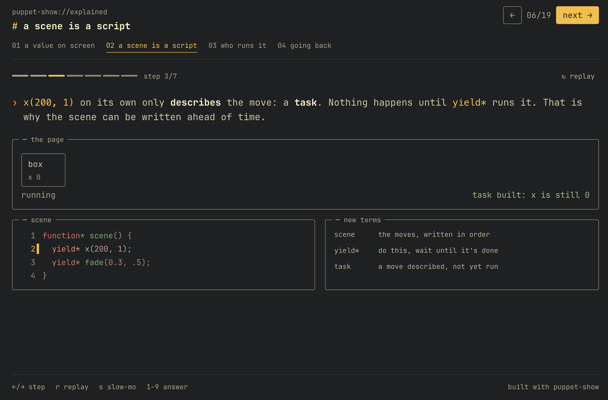
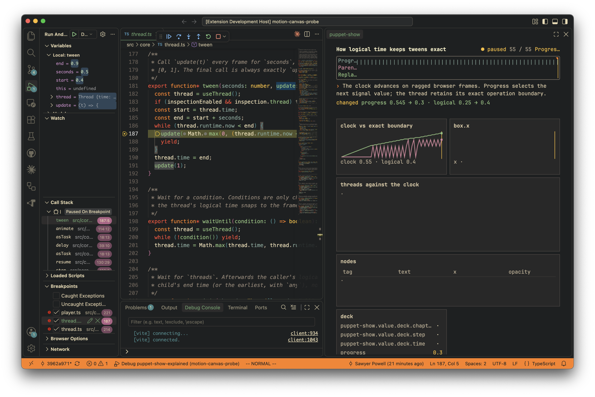

# puppet-show

> **AI usage disclosure.** This project was written almost entirely by AI coding
> agents (Anthropic Claude orchestrating, with Claude and OpenAI GPT subagents) working in the
> pi coding harness. The code, tests, docs, design system and the
> explainer were generated by those agents. Sawyer Powell directed the work:
> goals, design decisions, critique and acceptance. Correctness was checked with
> the automated tests and browser checks in this repo plus review of screenshots,
> not a line-by-line human audit. Treat it as experimental.

[](examples/puppet-show-explained)

**Start here: [`examples/puppet-show-explained`](examples/puppet-show-explained)** is a
19-step interactive explainer of puppet-show, built with puppet-show. It
introduces signals, tweens, scenes, `yield*`, the player and replay in order,
with a prediction question once you have the pieces. Build and open it:

```sh
npm install
npm run build puppet-show-explained
open dist/examples/puppet-show-explained/index.html
```

Also here: an [experimental VS Code debugger](#experimental-vs-code-debugger)
that records and scrubs an explainer's state.

Generator-driven, signal-based animation for interactive explainers in the DOM.
It borrows Motion Canvas semantics (scenes are generators, properties are
signals, `yield*` sequences time) and adds click-through steps, seeking by
replay, and a quiet terminal design language. One command builds an explainer
into a single self-contained HTML file (~85 KB, fonts included) that works
offline, from `file://`, or in a sandboxed HTML embed (e.g. a Notion HTML block).

```ts
import { deck, el, panel, narrate, beat, all, type View } from "puppet-show";

function* intro(view: View) {
  const box = el("div.ps-box", { opacity: 0 }, "box");
  view.add(panel("stage", {}, box));

  yield* narrate("A *signal* with a duration is a tween.", box.opacity(1, 0.4));
  yield* beat();
  yield* narrate("`all()` runs tasks in parallel.", all(box.x(200, 1), box.text("moved", 0.6)));
}

deck(document.body, { path: "puppet-show://demo", chapters: [{ title: "intro", scene: intro }] });
```

## Commands

| command | what |
| --- | --- |
| `npm run dev` | serve `examples/` with hot reload (open `/puppet-show-explained/`) |
| `npm run build [name...]` | each example → `dist/examples/<name>/index.html`, fully inlined |
| `npm run build:lib` | `dist/lib/puppet-show.js` + `dist/lib/puppet-show.css` for use in a web app |
| `npm test` | runtime semantics (node, no browser) |
| `npm run typecheck` | `tsc --noEmit` |
| `npm run verify -- <name> --quick` | inner loop: scoped typecheck + build only, fail fast |
| `npm run verify -- <name>` | typecheck + build + screenshots at 720/420 + live motion pass + replay check + contact sheets (~10-15s) |
| `npm run verify -- <name> --realtime` | same checks, real-time playback (timing debugging; slower) |

The one example, `examples/puppet-show-explained`, explains puppet-show itself:
scenes as generators, `yield` vs `yield*`, logical time, and seeking by replay.
`recipes/gallery` is the component catalogue with copyable recipes.

## Experimental: VS Code debugger



`vscode/` is an experimental VS Code extension for understanding *program
state*, not debugger mechanics. An agent (or you) writes a session file of
probes and collectors; the extension records state at each probe while the
explainer runs and renders it in a pinned pane: a scrubber over every stop,
what changed, and declared views such as "clock vs exact boundary". VS Code
keeps its own source view and controls. Sessions are plain files plus a URI
handler; there is no network listener.

```sh
npm run build:extension
code --extensionDevelopmentPath="$PWD/vscode" .
npm run session -- start docs/debugger/logical-time.puppet-show-session.json
```

Details: [`docs/debugger/AGENT.md`](./docs/debugger/AGENT.md). Pane size:
setting `puppet-show.paneScale`.

Full signatures: [`docs/API.md`](./docs/API.md). Recipes: `recipes/gallery/`.
Agents: start with [`AGENTS.md`](./AGENTS.md). Explainer design guidance:
[`skills/explainer-design/SKILL.md`](./skills/explainer-design/SKILL.md).
The runtime provides composable capabilities; the skill discusses how to use them.

## Model

- **Signal**: `const x = signal(0)`. `x()` reads, `x(5)` writes, `x(5, 0.4, ease)` returns
  a tween task. `.to(v, d)` chains keyframes. Numbers lerp, hex colours blend,
  other strings *retype* (erase to common prefix, then type).
- **Task**: a generator. `yield` waits one frame; `yield* task` runs it to
  completion; `yield task` forks it.
- **Flow**: `all`, `any`, `chain`, `sequence(stagger, ...)`, `delay`, `loop`,
  `waitFor`, `waitUntil`. Plain callbacks are allowed as instant steps.
- **Logical time**: every thread records exactly when its last operation was
  meant to end; the next one starts from there, not from the late frame. Chains
  never drift and results do not depend on frame rate.
- **Beat**: `yield* beat()` ends a step. The player stops the clock there.
- **Seek = replay**: to show step *i*, the player disposes the run, reruns the
  scene generator and fast-forwards at 1/60 s with effects held, then flushes
  once (~2 µs per simulated frame). Scenes never need undo code.
- **Node**: `el("div.cls", props, ...children)` returns a `Node` with `x`, `y`,
  `scale`, `rotate`, `opacity`, `text` signals, plus `css(prop)`, `attr(name)`
  and `flag(class)` signals. Layout stays in CSS. Function-valued props and
  children are reactive.
- **Layout-aware motion**: `fly(from, to, label)` sends a token through the
  overlay; `move(node, parent)` reparents with FLIP. Both skip measurement
  while seeking.
- **Deep links**: deck steps use `#chapter/ending-beat` URLs; `deck.href()` builds links, `hash: false` opts out, and `hash: "push"` enables Back/Forward.
- **Deck**: chapters are scenes; beats are steps. `say()` / `narrate()` set
  the caption instantly by default (typing is opt-in). Keys: `←/→` step, `r` replay, `s` slow-mo. Honours
  `prefers-reduced-motion` by jumping to the end of each step.

State that must survive replays (slider values, user input) lives in signals
created *outside* the scene function; the scene reads them reactively.

## Design language

Gruvbox dark hard, JetBrains Mono NL (subset, OFL, embedded), one size scale
(11 / 13 / 15 px). Hairline TUI frames with the title cut into the border,
colour reserved for meaning: yellow = focus/accent, aqua = values,
orange = prompt, red = error/drift, blue/purple/aqua/green to tell lanes apart.
Tokens are CSS variables (`--ps-*`) and `palette` in JS. See
[`AGENTS.md`](./AGENTS.md) for the authoring contract.

## Layout

```
src/core/   signal, thread (runtime + logical time), flow, player, ease, interp
src/dom/    node (reactive elements), view (fly, move)
src/ui/     optional deck shell, code, components, markup, puppet-show.css, fonts/
src/blocks/ input, annotations, focus, temporal traces, composition, orientation
examples/   one explainer: puppet-show-explained
recipes/    gallery: copyable component recipes
test/       runtime and browser tests
scripts/    build, verify, design/API gates, debugger session CLI
src/inspect/ opt-in state inspector + debugger pane views (webview bundle)
vscode/     VS Code debugger extension
```
